# Architecture

> Update this page at the end of every lesson. It is the diagram you present at
> the oral defence.

## Context

Albert's Marketplace is a fictional European beauty-products marketplace with
a PostgreSQL operational database, a FastAPI/Streamlit storefront and a Kafka
clickstream. The student platform will support daily units sold per product
and country without serving analytical queries from the checkout database.
The target is a two-tier architecture: a raw Parquet lake in GCS followed by
selected native BigQuery tables and curated analytical models. Bronze retains
arrival evidence, Silver will establish trusted records, and Gold will expose
shared business measures. Step 2 has deployed and verified the raw GCS snapshot.
Step 3 is complete for the selected Route 3 (no Airbyte): a hand-written
psycopg orders extractor, a Python clickstream consumer, and Debezium Connect
with a Python CDC-to-GCS consumer using the group's existing PostgreSQL
publication and slot. Live evidence covers the initial snapshot, seven CDC
tables, a synthetic CRUD sequence, connector and sink restart/resume, and
current slot/WAL status. See [CDC evidence](evidence/step3/cdc-status.json).
The orders catch-up advanced its cursor to 225405; two rows were already above
that watermark at its post-run check. Step 4 has deployed external Bronze tables and native monthly-partitioned
sales tables. Silver and Gold remain planned for Lesson 5.

## Context and target diagram

Solid arrows describe the implemented ingestion flows and verified Bronze
objects. Dashed arrows describe planned Silver and Gold work. Bronze inventory and
Parquet checks read object metadata and footers; the CDC CRUD check inspected
only its synthetic test key/events. The DLQ body was not read.

```mermaid
flowchart LR
    subgraph source[Source services - PostgreSQL, Kafka and Debezium verified]
        shop[Shopper / Streamlit]
        api[FastAPI storefront]
        pg[(PostgreSQL 17)]
        live[Live traffic generator]
        kafka[Kafka: clickstream JSON]
        csv[Versioned CSV release]
        shop --> api
        api -->|Operational SQL reads and writes| pg
        pg -->|Buyer and catalogue reads| live
        live -->|Simulated HTTP requests| api
        live -->|Versioned events| kafka
    end

    subgraph ingestion[Step 2 deployed - Step 3 complete: Python, no Airbyte]
        initial[CSV to Snappy Parquet with uv - verified]
        python[Python orders ID cursor - GCS objects and footers verified]
        consumer[Python Kafka + JSON Schema v1 - GCS objects and footers verified]
        debezium[Debezium Connect - existing PostgreSQL slot/publication]
        cdc_sink[Python raw CDC Kafka consumer]
    end

    subgraph gcp[Google Cloud: europe-west1 - Bronze and warehouse deployed]
        bronze[(GCS: data-engineering-i1-marketplace-group)]
        dlq[(GCS bronze/_dlq/: rejected events)]
        ext[(BigQuery g07_bronze: snapshot and selected live external tables)]
        raw[(BigQuery g07_warehouse: native orders and order_lines)]
        mv[(Daily-demand materialised view: provisional performance aggregate)]
        silver[(BigQuery Silver: curated records - Lesson 5)]
        gold[(BigQuery Gold: daily-demand star - Lesson 5)]
    end

    csv --> initial
    initial -->|bronze/snapshot/table / ingestion_date / load_id| bronze
    pg -->|orders, higher visible IDs only| python
    kafka --> consumer
    python -->|verified objects| bronze
    consumer -->|verified objects: raw bytes + provenance / UTC event_date| bronze
    consumer -->|verified test DLQ object| dlq
    pg -->|pgoutput, seven published tables| debezium
    debezium -->|table topics| kafka
    kafka --> cdc_sink
    cdc_sink -->|raw envelopes + Kafka provenance| bronze
    bronze -->|Pinned snapshot and separate live prefixes| ext
    ext -->|Typed snapshot only| raw
    raw -->|Group by product and day| mv
    raw -.->|Type, reconcile and check| silver
    silver -.->|Aggregate shared measures| gold
    gold -.-> reports[Analysts / business reports]
```

The Python `orders` path captures higher visible IDs only. It misses updates,
deletes and lower IDs committing after its cursor, and is not CDC. Debezium CDC
separately captures row-level changes for all seven published tables. Kafka
offsets are committed only after all valid/DLQ writes in a poll; replay can
duplicate records. Sales models must not combine overlapping copies.
Clickstream supports behaviour analysis; it is not an additional source of sold
units.

## Layers

| Component | Current status: 2026-11-05 | Next verification |
|---|---|---|
| PostgreSQL and Kafka | Live source connections verified; Compose services and CDC topics active for the Step 3 run | Keep the shared source and broker available; check connector, sink lag and retained WAL before operating |
| Shared Bronze bucket | Verified `gs://data-engineering-i1-marketplace-group`, `europe-west1`, Standard; Step 3 objects written with operator ADC; public access prevention enforced, uniform access enabled | Each team member must authenticate with their own Google identity and verify bucket access; audit inherited permissions |
| Partitioned Parquet snapshot | Seven raw tables, 1,296,708 rows, 19 Snappy files and one completion manifest; Step 2 evidence records local round-trips and remote checksums | Keep Step 3 outputs in distinct paths and record the snapshot-to-incremental handover |
| Lifecycle and bucket IAM | Live rules and policy exported; non-deleting transitions at 30/90/365 days; broad project convenience-group grants remain | Review effective access and future least-privilege identities |
| Airbyte | Not selected; unconfigured proposal artifacts remain under `ingestion/airbyte/` | No Airbyte action for Route 3 |
| Custom SQL extractor | Implemented; 50 GCS Parquet objects / 225,381 rows verified through footers after catch-up | Insert-only cursor is not CDC; preserve its local checkpoint to resume, or start from zero for a fresh backfill; CDC is authoritative for row changes |
| Kafka consumer and DLQ | 129 main-topic files / 29,144 rows, 2 isolated-test rows, and one DLQ object verified; schema and Snappy compression consistent | At-least-once replay may duplicate output; retain consumer offsets and reconcile by provenance; footer checks do not prove semantic validity or deduplication |
| PostgreSQL CDC | Debezium snapshot completed; connector/task RUNNING on existing seven-table publication and `pgoutput` slot; 746 GCS objects observed, all 21 Kafka partitions caught up, and slot retained 130,600 WAL bytes at 16:20 UTC | Snapshot overlaps earlier snapshot/backfill; TRUNCATE requires a coordinated full snapshot/reset; at-least-once GCS delivery. See [CDC evidence](evidence/step3/cdc-status.json) |
| BigQuery external Bronze tables | Seven pinned snapshot tables and Python orders / main clickstream external tables; [evidence](evidence/step4/external-tables-step3.json) | CDC stays raw in GCS until envelope reconciliation is implemented |
| Native BigQuery working tables | `g07_warehouse.orders` and `order_lines`, monthly partitions; order_lines clustered by product; snapshot only | See [warehouse tuning](warehouse-tuning.md) for measurements, materialisation and cost cap |
| Silver and Gold | Model design only | Lesson 5: implement and test business transformations |

## Bronze, Silver and Gold contracts

Bronze's initial snapshot and Step 3 object paths have been verified against
the contract below using object listings and Parquet footers. The CDC event
values inspected were limited to the synthetic CRUD test records; the DLQ body
was not read. Silver and Gold remain target contracts.

| Layer | Contains | Required guarantees | Intended readers |
|---|---|---|---|
| Bronze: GCS | Initial raw snapshot; selected Route 3 orders extract; accepted clickstream events; separate rejected-event path | Preserve admitted values and source columns, duplicates, phone strings, NA-like strings and source defects. Add clearly identified provenance. Exclude password/card-secret columns before landing. Keep ingestion paths separate and never silently overwrite prior arrival evidence. No business-cleanliness guarantee. | Ingestion and restricted curation roles |
| Silver: BigQuery | Typed and reconciled relational records; validated event fields; one country mapping per buyer; recorded exceptions | Apply explicit, tested duplicate/replay rules. Keep source lineage and ambiguous cases. Check keys, joins and quantity types. Establish one analytical record per intended business entity before aggregation. | Data engineers and authorised analysts |
| Gold: BigQuery | Product/date/country dimensions and daily-demand facts; shared reporting definitions | One fact row per product, country and day; additive `units_sold`; reconciled totals and documented unknown-country handling. Publish only successful daily refreshes and record the data cutoff. | Analysts and business reports |

## Decisions

| ADR | Decision | Status |
|---|---|---|
| [0001](adr/0001-target-architecture.md) | Two-tier GCS and BigQuery | Accepted |
| [0003](adr/0003-ingestion-modes.md) | Python and Debezium ingestion | Live evidence recorded |
| [0004 layout](adr/0004-warehouse-tables.md) | Selected native tables | Accepted |
| [0004 pricing](adr/0004-warehouse-pricing.md) | On-demand with per-query caps | Accepted |

## Bronze paths

| Prefix | Status |
|---|---|
| `bronze/snapshot/<table>/ingestion_date=YYYY-MM-DD/load_id=<id>/` | Verified: initial raw CSV-derived snapshots, with source hashes and unique load identity |
| `bronze/_manifests/<load-id>.json` | Verified: completion marker and source/row/file checksums |
| `bronze/python/orders/ingestion_date=.../` | Verified: 50 Parquet objects / 225,381 rows, IDs from 1 through 225405; includes an initial backfill overlapping the Step 2 orders snapshot |
| `bronze/kafka/<topic>/event_date=.../` | Verified: 129 main-topic objects / 29,144 rows across 10 dates; one consistent schema and Snappy compression |
| `bronze/_dlq/<topic>/rejection_date=.../` | One isolated-test DLQ object verified by name/size only; body not read |
| `bronze/cdc/<table>/ingestion_date=.../` | Debezium initial snapshot and row-level events for all seven published tables; synthetic CRUD and tombstone verified |

Step 2 uses ingestion date because all seven tables can be landed without joins
or source-value changes. Readers must select a completed load rather than sum
all snapshots. The current verified reader/writer is the uploader's ADC identity
through project permissions; dedicated curation and warehouse readers are planned.
See [actual IAM](../infra/iam.md) for the broad project grants and the limits of
the access audit. No separate member-access or least-privilege claim is made.

The [applied lifecycle](../infra/lifecycle.json) transitions `bronze/` objects to
Nearline at age 30 days, Coldline at 90 and Archive at 365, without deletion.
The bucket also has a seven-day soft-delete policy. Credentials stay outside
Git. Step 3's clickstream implementation accepts late events into their UTC
event-date partition and stores invalid events by rejection date. Debezium
uses the group's existing seven-table publication and `pgoutput` slot; the
Python consumer stores raw change envelopes, tombstones and Kafka provenance
in `bronze/cdc/`. At the 2026-11-05 16:20 UTC check, the slot was active, its
confirmed LSN was advancing, and it retained 130,600 WAL bytes under the
512 MB cap. The publication excludes `TRUNCATE`; treat a truncate as a source
reset requiring a coordinated full snapshot and downstream reconciliation.
Airbyte is not part of this route.

At the pre-catch-up 2026-11-05 source check, 199 rows were above cursor 225168.
The one-shot extractor then landed 237 rows through 225405. The source had two
rows above that watermark at the post-run check. Use the [Bronze verification
evidence](evidence/step3/bronze-verification.json) for the inventory and run
details.

## Model and design references

- [Target architecture ADR](adr/0001-target-architecture.md)
- [Flow matrix and risk analysis](data-flows.md)
- [Daily-demand star](model/star-daily-demand.md)
- [Source dataset card](dataset-card.md)
- [Bronze layout ADR](adr/0002-bronze-layout.md)
- [Step 2 setup and verification](bronze-setup.md)
- [Data dictionary](data-dictionary.md) and [cost baseline](costs.md)
- [Live bucket evidence](evidence/step2/bucket.json) and [upload receipt](evidence/step2/upload-receipt.json)
- [Step 3 ingestion jobs](../ingestion/README.md), [failure modes](ingestion-failure-modes.md)
  and [ingestion-mode ADR](adr/0003-ingestion-modes.md)
- [Docker operator handoff](runbooks/step3-docker-handoff.md) and [local checks](evidence/step3/local-checks.json)

Update this diagram and the implementation-status table after each step using
the actual resource identifiers and verification results.
