# Platform architecture

## Context

Albert's Marketplace is a fictional European beauty-products marketplace with
a PostgreSQL operational database, a FastAPI/Streamlit storefront and a Kafka
clickstream. The student platform will support daily units sold per product
and country without serving analytical queries from the checkout database.
The target is a two-tier architecture: a raw Parquet lake in GCS followed by
selected native BigQuery tables and curated analytical models. Bronze retains
arrival evidence, Silver will establish trusted records, and Gold will expose
shared business measures. This Step 1 document describes the target; cloud
resources, ingestion schedules and data-quality guarantees are not yet verified.

## Context and target diagram

Solid arrows describe flows implemented in the provided source code. Dashed
arrows describe planned platform flows. The source stack's runtime status has
not been checked as part of Step 1.

```mermaid
flowchart LR
    subgraph source[Provided source system - code present]
        shop[Shopper / Streamlit]
        api[FastAPI storefront]
        pg[(PostgreSQL 17)]
        live[Live traffic generator]
        kafka[Kafka: clickstream JSON]
        csv[Versioned CSV release]
        shop --> api
        api -->|Operational SQL reads and writes| pg
        pg -->|Buyer and catalogue reads| live
        live -->|Simulated HTTP requests| api
        live -->|Versioned events| kafka
    end

    subgraph ingestion[Planned ingestion - Steps 2 and 3]
        initial[Selected CSV snapshots - Step 2]
        connector[PostgreSQL connector: seven tables]
        python[Python extractor: orders, separate path]
        consumer[Kafka consumer: schema validation]
    end

    subgraph gcp[Target Google Cloud region: europe-west1]
        bronze[(GCS Bronze: shared group bucket / Parquet)]
        dlq[(GCS bronze/_dlq/: rejected events)]
        raw[(BigQuery: selected native raw working tables - Step 4)]
        silver[(BigQuery Silver: curated records - Lesson 5)]
        gold[(BigQuery Gold: daily-demand star - Lesson 5)]
    end

    csv -.-> initial
    initial -.-> bronze
    pg -.-> connector
    pg -.-> python
    kafka -.-> consumer
    connector -.-> bronze
    python -.-> bronze
    consumer -.->|Valid events| bronze
    consumer -.->|Invalid payload, reason and time| dlq
    bronze -.->|Load selected authoritative tables| raw
    raw -.->|Type, reconcile and check| silver
    silver -.->|Aggregate shared measures| gold
    gold -.-> reports[Analysts / business reports]
```

The connector's seven tables are `orders`, `order_items`, `review`,
`product_reviews`, `product`, `customer_shipping` and `shipping_details`.
The Python `orders` path demonstrates incremental SQL extraction and remains
separate from the connector path. Sales models must not combine overlapping
copies. Clickstream supports behaviour analysis; it is not an additional
source of sold units.

## Implementation status

| Component | Step 1 status | Next verification |
|---|---|---|
| PostgreSQL, storefront, Kafka and generator | Implementation present in this repository; runtime not checked | Start the source stack and inspect health and sample records when ingestion work begins |
| Shared Bronze bucket | Planned; no group bucket identifier verified | Step 2: record actual bucket, region, partition layout, IAM and lifecycle |
| Partitioned Parquet | Planned for selected raw exports | Step 2: preserve source values and measure layout choices |
| Connector, extractor, consumer and DLQ | Planned | Step 3: demonstrate independent writes, schema rejection and restart behaviour |
| Native BigQuery working tables | Planned | Step 4: record dataset, selected tables, load jobs and query evidence |
| Silver and Gold | Model design only | Lesson 5: implement and test business transformations |

## Bronze, Silver and Gold contracts

These are target contracts. A layer must not be described as operational until
its implementation and verification evidence exist.

| Layer | Contains | Required guarantees | Intended readers |
|---|---|---|---|
| Bronze: GCS | Selected raw exports and connector/extractor records in partitioned Parquet; accepted clickstream events; a separate rejected-event path | Preserve admitted values and source columns, duplicates, phone strings, NA-like strings and source defects. Add clearly identified provenance. Exclude password/card-secret columns before landing. Keep ingestion paths separate and never silently overwrite prior arrival evidence. No business-cleanliness guarantee. | Ingestion and restricted curation roles |
| Silver: BigQuery | Typed and reconciled relational records; validated event fields; one country mapping per buyer; recorded exceptions | Apply explicit, tested duplicate/replay rules. Keep source lineage and ambiguous cases. Check keys, joins and quantity types. Establish one analytical record per intended business entity before aggregation. | Data engineers and authorised analysts |
| Gold: BigQuery | Product/date/country dimensions and daily-demand facts; shared reporting definitions | One fact row per product, country and day; additive `units_sold`; reconciled totals and documented unknown-country handling. Publish only successful daily refreshes and record the data cutoff. | Analysts and business reports |

The native raw BigQuery tables introduced in Step 4 are selected working
copies of Bronze; loading them does not turn them into Silver. A performance
aggregation or materialised view in Step 4 is provisional until Lesson 5
implements the business reconciliation rules.

## Proposed storage and access boundaries

Use one shared group bucket in `europe-west1`. The actual bucket name and
partition key are deferred to Step 2 and must be updated here after verification.
At a minimum, distinguish the following prefixes:

| Prefix | Purpose |
|---|---|
| `bronze/snapshot/<table>/` | Initial CSV-derived snapshots with a recorded dataset version and load ID |
| `bronze/postgres/<table>/` | Authoritative connector arrivals |
| `bronze/python/orders/` | Custom extractor arrivals, excluded from the authoritative sales union |
| `bronze/kafka/clickstream/` | Accepted events with schema and offset provenance |
| `bronze/_dlq/` | Original rejected events, reasons and rejection timestamps |

Step 2 will add daily partition directories and unique batch/file identities
after measuring the layout. Step 3 will specify event-time versus ingestion-time
partitioning for clickstream and late-event handling. Store credentials outside
Git, use read-only PostgreSQL extraction access, and grant access per role.
Step 2 must commit actual IAM and lifecycle evidence, rather than treating
these intended controls as already applied.

## Model and design references

- [Target architecture ADR](adr/0001-target-architecture.md)
- [Flow matrix and risk analysis](data-flows.md)
- [Daily-demand star](model/star-daily-demand.md)
- [Source dataset card](dataset-card.md)

Update this diagram and the implementation-status table after each step using
the actual resource identifiers and verification results.
