# Platform architecture

## Context

Albert's Marketplace is a fictional European beauty-products marketplace with
a PostgreSQL operational database, a FastAPI/Streamlit storefront and a Kafka
clickstream. The student platform will support daily units sold per product
and country without serving analytical queries from the checkout database.
The target is a two-tier architecture: a raw Parquet lake in GCS followed by
selected native BigQuery tables and curated analytical models. Bronze retains
arrival evidence, Silver will establish trusted records, and Gold will expose
shared business measures. Step 2 has deployed and verified the raw GCS snapshot;
automated ingestion, the warehouse and the curated models remain planned.

## Context and target diagram

Solid arrows describe the provided source-code flows and the verified Step 2
CSV-to-GCS path. Dashed arrows describe planned platform flows. The source
stack's runtime status has not been checked; the status table distinguishes it
from the cloud bucket and upload that were actually verified on 2026-10-26.

```mermaid
flowchart LR
    subgraph source[Provided source system - code present]
        shop[Shopper / Streamlit]
        api[FastAPI storefront]
        pg[(PostgreSQL 17)]
        live[Live traffic generator]
        kafka[Kafka: clickstream JSON]
        csv[Versioned CSV release]
        shop --> api
        api -->|Operational SQL reads and writes| pg
        pg -->|Buyer and catalogue reads| live
        live -->|Simulated HTTP requests| api
        live -->|Versioned events| kafka
    end

    subgraph ingestion[Step 2 snapshot deployed - Step 3 automation planned]
        initial[CSV to Snappy Parquet with uv - verified]
        connector[PostgreSQL connector: seven tables]
        python[Python extractor: orders, separate path]
        consumer[Kafka consumer: schema validation]
    end

    subgraph gcp[Google Cloud: europe-west1 - Bronze deployed, warehouse planned]
        bronze[(GCS: data-engineering-i1-marketplace-group)]
        dlq[(GCS bronze/_dlq/: rejected events)]
        raw[(BigQuery: selected native raw working tables - Step 4)]
        silver[(BigQuery Silver: curated records - Lesson 5)]
        gold[(BigQuery Gold: daily-demand star - Lesson 5)]
    end

    csv --> initial
    initial -->|bronze/snapshot/table / ingestion_date / load_id| bronze
    pg -.-> connector
    pg -.-> python
    kafka -.-> consumer
    connector -.-> bronze
    python -.-> bronze
    consumer -.->|Valid events| bronze
    consumer -.->|Invalid payload, reason and time| dlq
    bronze -.->|Planned reader: restricted warehouse loader| raw
    raw -.->|Type, reconcile and check| silver
    silver -.->|Aggregate shared measures| gold
    gold -.-> reports[Analysts / business reports]
```

The connector's seven tables are `orders`, `order_items`, `review`,
`product_reviews`, `product`, `customer_shipping` and `shipping_details`.
The Python `orders` path demonstrates incremental SQL extraction and remains
separate from the connector path. Sales models must not combine overlapping
copies. Clickstream supports behaviour analysis; it is not an additional
source of sold units.

## Implementation status

| Component | Current status: 2026-10-26 | Next verification |
|---|---|---|
| PostgreSQL, storefront, Kafka and generator | Implementation present in this repository; runtime not checked | Start the source stack and inspect health and sample records when ingestion work begins |
| Shared Bronze bucket | Verified `gs://data-engineering-i1-marketplace-group`, `europe-west1`, Standard; public access prevention enforced, uniform access enabled | Have all group members test their actual Google access; audit inherited permissions |
| Partitioned Parquet | Seven raw tables, 1,296,708 rows, 19 Snappy files and one completion manifest; local value round-trips and remote checksums verified | Step 3: automate independent ingestion paths and explicit snapshot handover |
| Lifecycle and bucket IAM | Live rules and policy exported; non-deleting transitions at 30/90/365 days; broad project convenience-group grants remain | Review effective access and future least-privilege identities |
| Connector, extractor, consumer and DLQ | Planned | Step 3: demonstrate independent writes, schema rejection and restart behaviour |
| Native BigQuery working tables | Planned | Step 4: record dataset, selected tables, load jobs and query evidence |
| Silver and Gold | Model design only | Lesson 5: implement and test business transformations |

## Bronze, Silver and Gold contracts

Bronze's initial snapshot has been verified against the contract below. Silver,
Gold, automated events and the rejected-event path remain target contracts.

| Layer | Contains | Required guarantees | Intended readers |
|---|---|---|---|
| Bronze: GCS | Selected raw exports and connector/extractor records in partitioned Parquet; accepted clickstream events; a separate rejected-event path | Preserve admitted values and source columns, duplicates, phone strings, NA-like strings and source defects. Add clearly identified provenance. Exclude password/card-secret columns before landing. Keep ingestion paths separate and never silently overwrite prior arrival evidence. No business-cleanliness guarantee. | Ingestion and restricted curation roles |
| Silver: BigQuery | Typed and reconciled relational records; validated event fields; one country mapping per buyer; recorded exceptions | Apply explicit, tested duplicate/replay rules. Keep source lineage and ambiguous cases. Check keys, joins and quantity types. Establish one analytical record per intended business entity before aggregation. | Data engineers and authorised analysts |
| Gold: BigQuery | Product/date/country dimensions and daily-demand facts; shared reporting definitions | One fact row per product, country and day; additive `units_sold`; reconciled totals and documented unknown-country handling. Publish only successful daily refreshes and record the data cutoff. | Analysts and business reports |

The native raw BigQuery tables introduced in Step 4 are selected working
copies of Bronze; loading them does not turn them into Silver. A performance
aggregation or materialised view in Step 4 is provisional until Lesson 5
implements the business reconciliation rules.

## Actual Bronze storage and planned extensions

The group bucket is `gs://data-engineering-i1-marketplace-group`, in project
`data-engineering-i1`, region `europe-west1`. The completed snapshot uses
`ingestion_date=2026-10-26/load_id=20261026T105159Z-2efcb86a`. Every raw CSV field
is a string; even empty source headers are preserved. The following prefixes
separate the verified snapshot from future ingestion paths:

| Prefix | Status / purpose |
|---|---|
| `bronze/snapshot/<table>/ingestion_date=YYYY-MM-DD/load_id=<id>/` | Verified: initial raw CSV-derived snapshots, with source hashes and unique load identity |
| `bronze/_manifests/<load-id>.json` | Verified: completion marker and source/row/file checksums |
| `bronze/postgres/<table>/` | Planned: authoritative connector arrivals |
| `bronze/python/orders/` | Planned: custom extractor arrivals, excluded from the authoritative sales union |
| `bronze/kafka/clickstream/` | Planned: accepted events with schema and offset provenance |
| `bronze/_dlq/` | Planned: original rejected events, reasons and rejection timestamps |

Step 2 uses ingestion date because all seven tables can be landed without joins
or source-value changes. Readers must select a completed load rather than sum
all snapshots. The current verified reader/writer is the uploader's ADC identity
through project permissions; dedicated curation and warehouse readers are planned.
See [actual IAM](../infra/iam.md) for the broad project grants and the limits of
the access audit. No separate member-access or least-privilege claim is made.

The [applied lifecycle](../infra/lifecycle.json) transitions `bronze/` objects to
Nearline at age 30 days, Coldline at 90 and Archive at 365, without deletion.
The bucket also has a seven-day soft-delete policy. Credentials stay outside
Git. Step 3 will specify clickstream partitioning and late-event handling and
introduce read-only source extraction credentials.

## Model and design references

- [Target architecture ADR](adr/0001-target-architecture.md)
- [Flow matrix and risk analysis](data-flows.md)
- [Daily-demand star](model/star-daily-demand.md)
- [Source dataset card](dataset-card.md)
- [Bronze layout ADR](adr/0002-bronze-layout.md)
- [Step 2 setup and verification](bronze-setup.md)
- [Data dictionary](data-dictionary.md) and [cost baseline](costs.md)
- [Live bucket evidence](evidence/step2/bucket.json) and [upload receipt](evidence/step2/upload-receipt.json)

Update this diagram and the implementation-status table after each step using
the actual resource identifiers and verification results.
