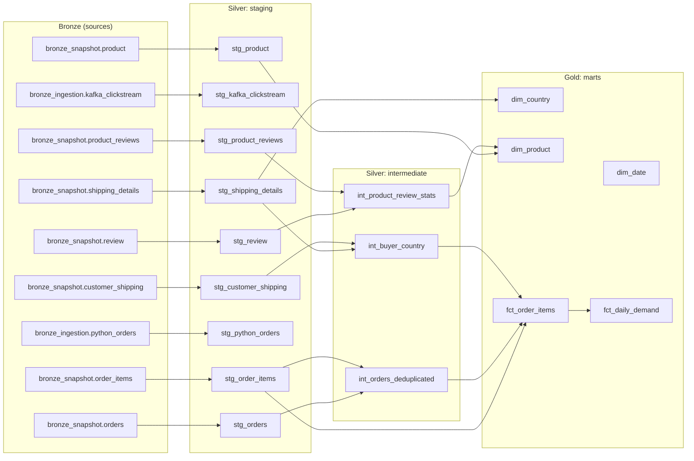

# Lineage

How data flows from the Bronze tables to the gold star, as dbt sees it. The
diagram and the table are generated from dbt's own manifest, so they cannot
drift from the code:

```bash
cd transform
uv run --locked dbt docs generate --profiles-dir .
python lineage.py
```

For the interactive graph with column documentation, run
`uv run --locked dbt docs serve --profiles-dir .` and open the lineage view
(`target/` is not committed, as the project rules require).

<!-- lineage:start -->


| Source | Models downstream | Gold models reached |
|---|---:|---|
| `bronze_ingestion.kafka_clickstream` | 1 | none |
| `bronze_ingestion.python_orders` | 1 | none |
| `bronze_snapshot.customer_shipping` | 4 | `fct_daily_demand`, `fct_order_items` |
| `bronze_snapshot.order_items` | 4 | `fct_daily_demand`, `fct_order_items` |
| `bronze_snapshot.orders` | 4 | `fct_daily_demand`, `fct_order_items` |
| `bronze_snapshot.product` | 2 | `dim_product` |
| `bronze_snapshot.product_reviews` | 3 | `dim_product` |
| `bronze_snapshot.review` | 3 | `dim_product` |
| `bronze_snapshot.shipping_details` | 5 | `dim_country`, `fct_daily_demand`, `fct_order_items` |
<!-- lineage:end -->

## If the most upstream source changed shape tomorrow

The most upstream sources are the seven snapshot tables in `g07_bronze`. Say
`order_items` changes: a column is renamed, a price starts using a comma, or a
new column appears. What to look at, in order:

1. **The external table first.** `scripts/warehouse.py` declares every Bronze
   table with an explicit all-string schema, and the table reads the Parquet
   files by those names. If a declared column disappears from the files, the
   table may fail or may return NULL for it: this has not been tested here, so
   check the table's schema and a few rows before trusting the rest. A new column
   is ignored until someone adds it to the declaration.
2. **Its staging model, `stg_order_items`.** If the external table's declaration
   renames a column, the model fails with an unrecognised-name error. The quiet case is a change of format, such as
   `1,50` instead of `1.50`: `safe_cast` returns NULL instead of failing, and the
   `not_null` tests on `quantity` and `unit_price_eur` are what catch it. This is
   the only place the source's shape is read, so it is the only model to edit.
3. **`int_orders_deduplicated`.** It builds each order's basket from `p_id`,
   `quantity` and `unit_price_eur` to recognise twins. A format drift that is
   applied to only some rows would make two copies of an order stop matching.
   `assert_dedup_halves_orders` and `assert_twin_groups_are_even` fail first.
4. **Then the facts.** `fct_order_items` and `fct_daily_demand` read only the
   staged columns. `assert_reconciled_lines_preserved` and the grain tests tell
   you whether sales were lost or repeated.

The table above gives the blast radius. `order_items` and `orders` reach both
facts, so a break there stops the star; `review` and `product_reviews` reach
only `dim_product`, so a break there leaves the sales numbers untouched.
`dbt build` skips every model downstream of a failing test, so a bad change stops
at the first failure rather than reaching gold.
