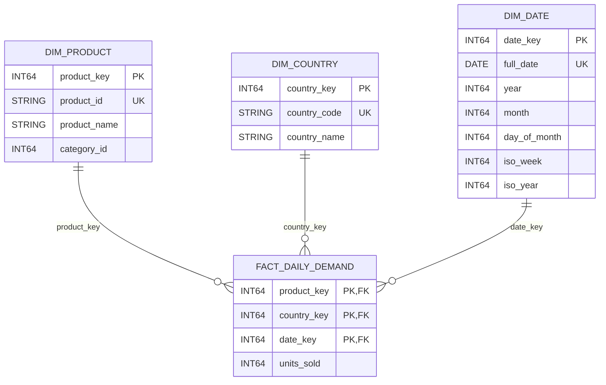

# Daily-demand star schema

## Business process and question

Measure product sales recorded by Albert's Marketplace checkout, using
relational orders and order lines as the authoritative source. The question
is: **How many units were sold for each product, in each country, on each day?**

This is the Lesson 1 design sketch. The star and its data-quality rules will
be implemented and tested in Lesson 5. Raw Bronze data remains unchanged.

## Grain

**One fact row represents the total units sold for one product, assigned to
one country, on one order date, after Silver reconciliation.**

The composite fact key is `(product_key, country_key, date_key)`. This is an
aggregate fact table, not one row per order or order line. Store rows for
observed sales; a missing combination does not create a stored zero-sales row.

## Schema sketch



`PK, FK` identifies each dimension key's role in the composite fact key and its
relationship to a dimension. Logical constraints must be checked in the
transformation pipeline; this diagram does not assert database enforcement.

## Dimensions

| Dimension | Natural key and source | Attributes | Initial history policy |
|---|---|---|---|
| `dim_product` | `product.p_id` | Product name from `p_name`, source `category_id`; surrogate `product_key` | Type 1 attributes for the initial model. Preserve raw versions in Bronze. Category names require an additional source table and are outside the initial seven-table scope. |
| `dim_country` | Normalised country from `shipping_details.country` | ISO alpha-2 code and display name; surrogate `country_key` | Static reference mapping for France (FR), Germany (DE), Italy (IT), Spain (ES), Netherlands (NL), Belgium (BE), plus `UNKNOWN` for missing/ambiguous data. `UNKNOWN` is an internal sentinel, not an ISO code. |
| `dim_date` | `orders.order_date` | Full date, year, month, day, ISO week and ISO year; integer `date_key` such as `20261026` | Calendar dimension with one row per date in the analytical range. |

`order_date` is a PostgreSQL `DATE`: use that stored calendar date without
inventing a timezone conversion. The generator can run on a simulated clock,
so neither extraction date nor Kafka `emitted_at` is the sales date.

## Fact and measure

| Field | Type | Definition |
|---|---|---|
| `product_key` | `INT64` | Foreign key to the sold product |
| `country_key` | `INT64` | Foreign key to the buyer's resolved country proxy |
| `date_key` | `INT64` | Foreign key to the recorded order date |
| `units_sold` | `INT64` | `SUM(order_items.qty)` over reconciled Silver order lines at the fact grain |

`units_sold` is additive across products, countries and days. Use purchased
quantity, not the number of lines, current `product.qty` stock, or the count of
clickstream events. Returns are not subtracted in this initial gross-demand
measure: the released returns table is empty and is outside the selected scope.
Do not introduce revenue until its price/discount/return definition is agreed.

## Join path and country limitation

Start from Silver order lines keyed by `(order_id, p_id)`, join the reconciled
order on `order_id`, and map `p_id` to `dim_product`. Map `order_date` to
`dim_date`. Resolve country through:

```text
orders.buyer_id = customer_shipping.c_id
customer_shipping.address_id = shipping_details.address_id
```

Build a separate buyer-country mapping using `is_default = '1'`. Require exactly
one valid default-address row per buyer before joining it to sales. If there is
no valid row, more than one default row, an orphan address or an unmapped country,
assign the order to the unknown country member and retain an exception. The
mapping must have at most one output row per buyer so it cannot multiply sales.

**This country is a proxy.** Neither `orders` nor `shipment` stores an order's
delivery `address_id`. The source therefore cannot prove the historical
delivery country. The initial model uses the buyer's default-address country
available at the input cutoff. Freeze and record that mapping with each model
build; a recomputation from a later snapshot can restate historical country
totals. An order-level address capture or a historical address model would be
needed for a stronger attribution. New sign-ups may have no saved address and
will use the unknown member.

## Reconciliation before aggregation

1. Select the connector stream as the authoritative automated relational input.
   Use an explicit handover from initial CSV snapshots; never add their full
   totals together. Keep custom-extractor output out of this sales input.
2. Reconcile repeated ingestion versions using source keys and provenance,
   then check order and order-line referential integrity.
3. Investigate business duplicates separately. The dataset deliberately has
   twin orders under different IDs, potentially on different dates. A primary
   key check or `DISTINCT order_id` cannot remove them. Define, review and test
   the business-match rule in Lesson 5; retain candidate groups, chosen records
   and ambiguous matches. Do not silently merge genuine repeat purchases or
   claim a clean sales total before this rule exists.
4. Join only to dimensions and the unique buyer-country mapping. Keep reviews,
   shipments and event rows out of the fact-building join to avoid fanout.
5. Sum quantities by product, resolved country and order date. Refresh affected
   dates when later reconciliation changes an order.

No exact deduplication algorithm is claimed in Step 1. Its unresolved definition
is a risk to the measure, to be resolved before Gold is treated as trusted.

## Acceptance checks for Lesson 5

- The composite fact key is unique and dimension natural keys are unique.
- Every fact row resolves to a date, product and country, including explicit
  unknown members where needed; orphan source products are reported.
- The country join preserves the number of reconciled order lines and their
  summed quantities. Missing/ambiguous country rows are counted separately.
- `units_sold` is a positive integer for each stored sales row.
- Summing fact quantities matches the reconciled Silver line quantities for
  the same input cutoff and reporting period, including unknown countries.
- Replaying the same input cutoff produces the same fact keys and quantities.
- Duplicate-order cases and genuine repeat-purchase cases exercise the agreed
  business rule. Record the unresolved cases and their effect on totals.
- A changed default address exposes the documented country-restatement
  limitation rather than being presented as historical delivery evidence.

## References

- [Operational schema](../../db/migrations/20260915120000_baseline.sql)
- [Order-line schema](../../db/migrations/20260915120100_order_items.sql)
- [Source defects and assumptions](../dataset-card.md)
- [Architecture decision](../adr/0001-target-architecture.md)
- [Data-flow risks](../data-flows.md)
